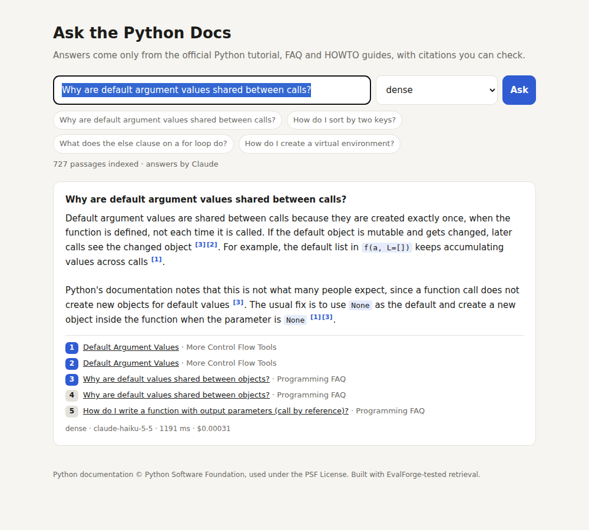
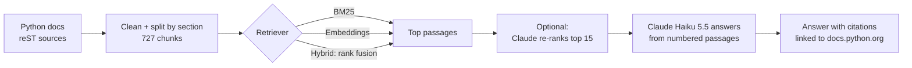

# pydocs-rag: Ask the Python Docs

A retrieval-augmented (RAG) assistant that answers Python questions **only from the official Python documentation**, cites the exact sections it used, and says so when the docs don't cover a question. Every design choice is measured with [EvalForge](https://github.com/akashkorada25/evalforge).



## Why this project

Most RAG demos stop at "it answers questions." This one asks **how well, and which design choices matter**:

- Does retrieval actually beat asking the model with no documents?
- Keyword search, embeddings, or both? Is LLM re-ranking worth the extra call?
- Are the answers **grounded** in the retrieved passages, or does the model add things?
- Does it **decline** questions the documentation doesn't cover, instead of making something up?

## Results

<!-- RESULTS:START -->
### Retrieval: did search find the section that answers the question?

32 in-scope questions, top-5 passages ([full results](results/retrieval.md)).

| Retriever | Recall@1 | Recall@5 | MRR@10 | Time / query |
|---|---|---|---|---|
| BM25 (keywords) | 40.6% | 78.1% | 0.559 | <1 ms |
| TF-IDF | 43.8% | 81.2% | 0.582 | 1 ms |
| **Dense (embeddings)** | **71.9%** | **90.6%** | **0.797** | 8 ms |
| Hybrid (BM25 + dense) | 68.8% | 84.4% | 0.769 | 7 ms |
| BM25 + Claude re-rank | 59.4% | 81.2% | 0.686 | 1.1 s |
| Hybrid + Claude re-rank | 71.9% | 87.5% | 0.796 | 1.1 s |
| Dense + Claude re-rank | 71.9% | 90.6% | 0.807 | 1.1 s |

### End to end: are the answers correct, grounded and honest?

38 questions (32 in scope, 6 out of scope). Answers by Claude Haiku 5.5, graded by Claude Sonnet 5.5 through EvalForge ([full results](results/end_to_end.md)).

| System | Correct | Grounded in sources | Cites sources | Declines out-of-scope | Median latency | Cost / question |
|---|---|---|---|---|---|---|
| No retrieval (closed-book) | **100%** | 0% | 12%\* | **0%** | 1.5 s | $0.0001 |
| BM25 | 81% | 94% | 100% | 100% | 1.5 s | $0.0004 |
| **Dense (default)** | **91%** | **100%** | **100%** | **100%** | 1.6 s | **$0.0003** |
| Hybrid | 91% | 100% | 100% | 100% | 1.6 s | $0.0004 |
| Dense + re-rank | 91% | 100% | 100% | 100% | 2.6 s | $0.0010 |

\* The closed-book model cites nothing; the citation check matched list output like `[1]` in its code.

### What the evaluation found

1. **Without retrieval, Claude already knew the answers, but it couldn't be trusted to stay in scope.** It answered all 32 in-scope questions correctly from its own knowledge. It also answered all 6 out-of-scope questions confidently, with no sources, including an outdated "latest NumPy version". The RAG versions declined all 6 and cited the exact section for every answer. Here, retrieval adds **trust and traceability**, not raw accuracy.
2. **Wrong answers came from retrieval misses, not hallucination.** With dense retrieval, answers were 100% grounded in the retrieved passages. Two of the three incorrect answers were questions where search missed the right section ("generators", "keyword-only arguments"), and Claude correctly said the provided docs didn't cover them. The third found the right section but not the part showing `json.dump()`. Better retrieval, not a bigger model, is the lever.
3. **Hybrid search was not better than embeddings alone.** Rank fusion gives keyword search an equal vote, and on paraphrased questions it pulls in wrong sections (recall@5 84% vs. 91%). The common advice to "always use hybrid" didn't hold for this data.
4. **Re-ranking helps weak retrievers, not strong ones.** Claude re-ranking lifted BM25's recall@1 from 41% to 59%, but didn't change dense recall at all, while tripling cost and adding a second of latency. It can only reorder what the first stage found, so it's off by default.
5. **It's cheap.** The default pipeline costs about $0.0003 per answer. The whole evaluation (190 answers plus about 350 judge calls) cost about $1.50, mostly for the judge.

These are 38 questions, so differences of a few points are within noise; the large gaps (no retrieval vs. RAG on scope, BM25 vs. dense on recall) are the reliable findings.
<!-- RESULTS:END -->

## How it works



1. **Ingestion** (`ragassist/ingest.py`): parses the reStructuredText sources of the Python tutorial, FAQ and six HOWTO guides; removes markup; splits by section heading; and packs paragraphs into ~220-word chunks with overlap. Each chunk keeps its page, section and a link to that exact section on docs.python.org.
2. **Retrieval** (`ragassist/retrievers.py`):
   - **BM25**: classic keyword search, implemented with sparse matrices.
   - **TF-IDF**: word and word-pair vectors with cosine similarity.
   - **Dense**: `BAAI/bge-small-en-v1.5` embeddings through fastembed (runs locally on CPU, no API).
   - **Hybrid**: reciprocal rank fusion of BM25 and dense rankings (no score tuning needed).
   - **Re-ranking**: Claude Haiku scores the top 15 candidates for relevance and re-orders them.
3. **Generation** (`ragassist/pipeline.py`): Claude Haiku 5.5 answers from numbered passages, cites them as `[n]`, and is told to say when the passages don't contain the answer. A **closed-book** mode (no documents) is the baseline.
4. **App** (`ragassist/server.py`): a small web chat and JSON API using only the standard library. The default retriever is dense, the best performer in the benchmark.

## How it's evaluated

**`eval/questions.yaml`** has 38 questions:

- **32 answerable questions**, written the way people actually ask ("I used an empty list as a default parameter and items keep piling up"), not copied from section titles. Each has the gold section(s) that answer it, key terms a correct answer must include, and a reference answer. A test checks that every gold section exists and contains those terms, so the labels can't silently drift from the corpus.
- **6 out-of-scope questions** (Flask on AWS, pandas, PyTorch...) that the assistant should decline.

Two layers of evaluation:

| Layer | What it measures | Cost |
|---|---|---|
| Retrieval benchmark (`pydocs-rag bench`) | Recall@1/3/5 and MRR: does each retriever rank a gold section near the top? | Free (re-ranking rows: ~$0.02) |
| End-to-end (EvalForge, `eval/rag_suite.yaml`) | For each system: **correct** (Claude Sonnet judge vs. reference), **grounded** (judge sees the retrieved passages), **key facts**, **cites sources**, **retrieved the right section**, **declines** out-of-scope questions | ~$1.50 per run |

The EvalForge suite is generated from `questions.yaml` by `eval/build_suite.py`, so there is one source of truth. It uses EvalForge's `python` provider to call the whole RAG pipeline, and its context-aware judge to check faithfulness.

## Quick start

```bash
git clone https://github.com/akashkorada25/pydocs-rag && cd pydocs-rag
pip install -e ".[dense]"            # drop [dense] for keyword search only

export ANTHROPIC_API_KEY=...         # optional: without it, the app quotes the best passage
pydocs-rag serve                     # open http://127.0.0.1:8000
pydocs-rag ask "How do I sort by two keys?"
```

```bash
pydocs-rag bench --retrievers bm25,tfidf,dense,hybrid           # retrieval benchmark (free)

pip install -e ".[dense,eval]"
python eval/build_suite.py
evalforge run eval/rag_suite.yaml --report report.html          # end-to-end (needs the API key)
pydocs-rag e2e-report                                           # per-check table
evalforge failures latest                                       # why cases failed
```

The API: `POST /api/ask` with `{"question": "...", "retriever": "hybrid", "k": 5}` returns the answer, sources with links, and token usage and cost. Links like `/?q=How%20do%20I%20sort%3F` open the page with that question answered.

## Project structure

```
ragassist/
  ingest.py       reST parsing, cleaning, section-aware chunking
  retrievers.py   BM25, TF-IDF, dense, hybrid (RRF), LLM re-ranking
  llm.py          Anthropic client (standard library) and offline fallback
  pipeline.py     retrieval + grounded generation with citations
  app.py          pipeline cache and the EvalForge entry point
  server.py       web app and JSON API
  bench.py        retrieval benchmark
  e2e_report.py   per-check summary of an EvalForge run
  static/         chat page
eval/
  questions.yaml  38 questions with gold sections and reference answers
  build_suite.py  generates the EvalForge suite
data/raw/         Python documentation sources (PSF License)
tests/            pytest: ingestion, retrievers, pipeline, server, eval data
```

## Design decisions

- **Section-aware chunks with titles.** Each chunk is indexed with its page and section titles, and FAQ sections are themselves questions, which helps both keyword and semantic matching.
- **Dense retrieval by default**, chosen from the benchmark rather than assumed. Hybrid search (reciprocal rank fusion) and re-ranking are available, but measured as no better on this data.
- **A cheap model for answers, a stronger one for judging.** Haiku 5.5 answers at a fraction of a cent per question; Sonnet 5.5 grades.
- **Evaluations never silently use the offline fallback.** The EvalForge entry point refuses to run without an API key unless told to.

## Limitations

- 38 questions is enough to see large differences between systems, not small ones. Treat differences of a few points as noise.
- An LLM judge can be wrong. EvalForge's `calibrate` command can measure its agreement with human labels.
- The corpus is a snapshot of the docs on CPython's main branch (see `data/LICENSE-PSF.txt` for the commit), linked to docs.python.org/3, so a few sections may differ from the version you use.

## License

Code: MIT. Python documentation in `data/raw/` and `ragassist/data/`: © Python Software Foundation, used under the PSF License Version 2 (see `data/LICENSE-PSF.txt`).
